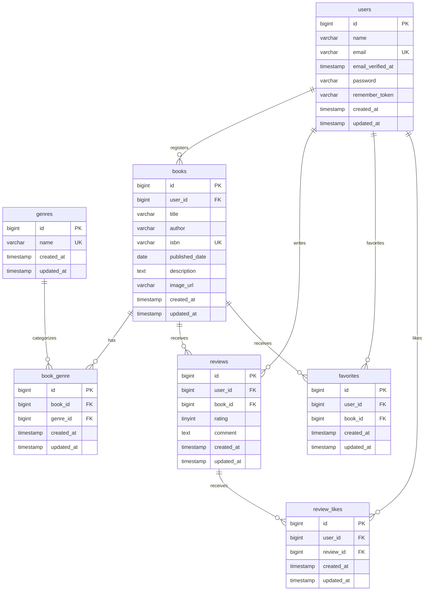

# BookShelf 書籍レビューアプリ

## 概要

書籍の登録・閲覧、レビュー投稿、お気に入り登録などを行うための書籍レビューアプリケーションです。

基本機能では、以下の機能を実装します。

- 会員登録・ログイン・ログアウト
- 書籍の登録・閲覧・編集・削除
- レビューの投稿・編集・削除
- お気に入り登録
- レビューへのいいね
- ジャンル管理
- 書籍ランキング
- 公開API（JSON）

基本機能の実装完了後、検索・外部API連携・読書レポートなどの応用機能を追加予定です。

---

## 環境構築

本プロジェクトは、Docker DesktopとLaravel Sailを使用して動作します。

### 前提条件

以下を使用できる状態にしてください。

- Git
- Docker Desktop
- WSL2（Windowsの場合）

Docker Desktopを起動してから、以降のコマンドを実行してください。

- **Windowsの場合**：WSL2のターミナルで実行します。
- **Macの場合**：ターミナルで実行します。

### 1. リポジトリをクローン

```bash
git clone git@github.com:akiko-11/bookshelf-app.git
cd bookshelf-app
```

### 2. Composer依存パッケージをインストール

ローカル環境でComposerを使用できる場合は、以下を実行します。

```bash
composer install
```

Composerを使用できない場合は、Dockerを利用してインストールします。

```bash
docker run --rm \
  -u "$(id -u):$(id -g)" \
  -v "$(pwd):/var/www/html" \
  -w /var/www/html \
  -e COMPOSER_CACHE_DIR=/tmp/composer_cache \
  laravelsail/php82-composer:latest \
  composer install
```

### 3. 環境設定ファイルを作成

```bash
cp .env.example .env
```

`.env`を開き、データベース接続情報を以下のように設定します。

```env
DB_CONNECTION=mysql
DB_HOST=mysql
DB_PORT=3306
DB_DATABASE=laravel
DB_USERNAME=sail
DB_PASSWORD=password
```

### 4. Laravel Sailを起動

```bash
./vendor/bin/sail up -d
```

コンテナの状態を確認します。

```bash
./vendor/bin/sail ps
```

以下のサービスが起動していることを確認してください。

- `laravel.test`
- `mysql`
- `phpmyadmin`

### 5. アプリケーションキーを生成

```bash
./vendor/bin/sail artisan key:generate
```

### 6. フロントエンドの依存パッケージをインストール

```bash
./vendor/bin/sail npm install
```

### 7. マイグレーションと初期データを実行

```bash
./vendor/bin/sail artisan migrate --seed
```

既存のテーブルを削除して初期状態から作り直す場合は、以下を実行します。

```bash
./vendor/bin/sail artisan migrate:fresh --seed
```

> `migrate:fresh`を実行すると、データベース内の既存データはすべて削除されます。

### 8. Vite開発サーバーを起動

```bash
./vendor/bin/sail npm run dev
```

画面を確認している間は、このコマンドを実行したままにしてください。

停止する場合は、実行中のターミナルで `Ctrl + C` を押します。

### 9. アクセス（URL）

ブラウザで以下へアクセスします。

| 画面 | URL |
| --- | --- |
| アプリケーション | `http://localhost` |
| 会員登録 | `http://localhost/register` |
| ログイン | `http://localhost/login` |
| phpMyAdmin | `http://localhost:8080` |

### 10. Sailエイリアスを設定（任意）

毎回 `./vendor/bin/sail` と入力せず、`sail`のみで実行したい場合は以下を設定します。

bashの場合：

```bash
echo "alias sail='[ -f sail ] && bash sail || bash vendor/bin/sail'" >> ~/.bashrc
source ~/.bashrc
```

zshの場合：

```bash
echo "alias sail='[ -f sail ] && bash sail || bash vendor/bin/sail'" >> ~/.zshrc
source ~/.zshrc
```

設定後は以下のように実行できます。

```bash
sail artisan migrate --seed
sail npm run dev
```

### 11. コンテナを停止

```bash
./vendor/bin/sail down
```

### Apple Silicon搭載Macについて

Apple Silicon搭載MacでSail起動時に以下のエラーが発生する場合があります。

```text
no matching manifest for linux/arm64/v8
```

その場合は、`compose.yaml`のMySQLサービスに以下を追加します。

```yaml
platform: 'linux/amd64'
```

---

## 使用技術

| 技術 | バージョン・用途 |
| --- | --- |
| HTML | 画面構造 |
| Tailwind CSS | 3.4.19 / スタイル設定 |
| Alpine.js | 3.17.4 / フロントエンド |
| PHP | 8.5.12 |
| Laravel | 10.50.3 |
| MySQL | 8.4.10 |
| Vite | フロントエンド開発環境 |
| Docker | コンテナ環境 |
| Laravel Sail | Docker開発環境の操作 |
| phpMyAdmin | データベース管理 |

---


## ER図

BookShelfでは、書籍・ジャンル・レビュー・お気に入り・レビューへのいいね情報を、以下の7つの業務テーブルで管理しています。



### 制約

各業務テーブルには主キーとして `id` を設定し、Laravelの規約に従って `created_at` と `updated_at` を設けています。

#### UNIQUE制約

| テーブル | 対象カラム | 内容 |
| --- | --- | --- |
| users | email | メールアドレスの重複を禁止 |
| genres | name | ジャンル名の重複を禁止 |
| books | isbn | ISBNの重複を禁止 |
| book_genre | book_id, genre_id | 同じ書籍とジャンルの組み合わせを禁止 |
| reviews | user_id, book_id | 同じユーザーによる同一書籍への重複レビューを禁止 |
| favorites | user_id, book_id | 同じユーザーによる同一書籍のお気に入り重複登録を禁止 |
| review_likes | user_id, review_id | 同じユーザーによる同一レビューへの重複いいねを禁止 |

複合UNIQUE制約は、複数カラムの組み合わせに対して設定しています。

`reviews` テーブルの複合UNIQUE制約は、追加マイグレーション `2026_10_19_020253_add_unique_user_book_to_reviews_table.php` で定義しています。

#### NOT NULL・NULL許可

| テーブル | カラム | 制約 |
| --- | --- | --- |
| users | name, email, password | NOT NULL |
| users | email_verified_at, remember_token | NULL許可 |
| genres | name | NOT NULL |
| books | user_id, title, author, isbn, published_date | NOT NULL |
| books | description, image_url | NULL許可 |
| book_genre | book_id, genre_id | NOT NULL |
| reviews | user_id, book_id, rating, comment | NOT NULL |
| favorites | user_id, book_id | NOT NULL |
| review_likes | user_id, review_id | NOT NULL |

#### その他の制約

- `books.isbn`：13文字の文字列として保存
- `reviews.rating`：符号なしTINYINT型で保存
- レビューの評価は、アプリケーション側のバリデーションで1〜5に制限
- レビューのコメントは、アプリケーション側のバリデーションで最大1000文字に制限

### リレーション

| モデル | リレーション | 関係 |
| --- | --- | --- |
| User → Book | books() | 1対多 |
| User → Review | reviews() | 1対多 |
| User → Favorite | favorites() | 1対多 |
| User → ReviewLike | reviewLikes() | 1対多 |
| Book → Review | reviews() | 1対多 |
| Book → Favorite | favorites() | 1対多 |
| Book → Genre | genres() | 多対多 |
| Genre → Book | books() | 多対多 |
| Review → ReviewLike | reviewLikes() | 1対多 |
| User → Book | favoriteBooks() | 多対多 |
| User → Review | likedReviews() | 多対多 |

多対多のリレーションには、以下の中間テーブルを使用しています。

- `book_genre`：書籍とジャンル
- `favorites`：ユーザーとお気に入り書籍
- `review_likes`：ユーザーといいねしたレビュー

いずれも `id` を主キーとし、関連する外部キーの組み合わせにUNIQUE制約を設定しています。

### 外部キー

| テーブル | 外部キー | 参照先 | 削除時の動作 |
| --- | --- | --- | --- |
| books | user_id | users.id | CASCADE |
| book_genre | book_id | books.id | CASCADE |
| book_genre | genre_id | genres.id | RESTRICT |
| reviews | user_id | users.id | CASCADE |
| reviews | book_id | books.id | CASCADE |
| favorites | user_id | users.id | CASCADE |
| favorites | book_id | books.id | CASCADE |
| review_likes | user_id | users.id | CASCADE |
| review_likes | review_id | reviews.id | CASCADE |

#### CASCADE

親レコードを削除すると、関連する子レコードも自動的に削除されます。

例：

- 書籍削除時に、その書籍のレビュー・お気に入り・ジャンルとの関連付けを削除
- レビュー削除時に、そのレビューへのいいね情報を削除
- ユーザー削除時に、そのユーザーが登録した書籍・レビュー・お気に入り・いいね情報を削除

#### RESTRICT

参照されている親レコードの削除を制限します。

`book_genre.genre_id` に設定しているため、書籍との関連付けが存在するジャンルは削除できません。

### 補助テーブルについて

LaravelやFortifyなどのフレームワークが使用する以下の補助テーブルは、業務テーブルとは分けて管理しています。

| テーブル | 用途 |
| --- | --- |
| password_reset_tokens | パスワードリセット用トークンの管理 |
| failed_jobs | 失敗したキュージョブの記録 |
| personal_access_tokens | APIトークンの管理 |
| migrations | マイグレーションの実行履歴 |

これらはアプリケーションの主要な業務データを管理するテーブルではないため、上記ER図には含めていません。

Fortifyの二要素認証機能は基本要件の対象外として無効化しています。二要素認証用カラムはマイグレーションに定義されていますが、本ER図では省略しています。

---

## APIエンドポイント一覧

基本機能では、以下の公開APIを実装します。

| HTTPメソッド | URI | 概要 | 認証 |
| --- | --- | --- | --- |
| GET | `/api/v1/books` | 書籍一覧を取得 | 不要 |
| GET | `/api/v1/books/{book}` | 書籍詳細を取得 | 不要 |
| POST | `/api/v1/books` | 書籍を新規登録 | 不要 |
| PUT | `/api/v1/books/{book}` | 書籍を更新 | 不要 |
| DELETE | `/api/v1/books/{book}` | 書籍を削除 | 不要 |

基本機能では公開APIに認証を設定しません。

応用機能では、POST / PUT / DELETE の書き込み系APIにLaravel Sanctumによるトークン認証を追加予定です。

---

## ログイン情報

Seederを実行すると、以下の動作確認用ユーザーが作成されます。

| 名前 | メールアドレス | パスワード |
| --- | --- | --- |
| 山田太郎 | `yamada@example.com` | `password` |
| 鈴木花子 | `suzuki@example.com` | `password` |
| 田中一郎 | `tanaka@example.com` | `password` |
| 佐藤美咲 | `sato@example.com` | `password` |
| 高橋健太 | `takahashi@example.com` | `password` |

---

## テスト

本プロジェクトでは、PHPUnitを使用してUnit TestとFeature Testを実装しています。

### テスト実行

すべてのテストを実行する場合：

```bash
./vendor/bin/sail artisan test
```

特定のテストディレクトリを実行する場合：

```bash
./vendor/bin/sail artisan test tests/Feature
```

### テストカバレッジ

```bash
./vendor/bin/sail artisan test --coverage
```

※ カバレッジ計測には、Xdebugなどのカバレッジドライバーを有効にする必要があります。

### コードスタイルの確認

Laravel Pintを使用してコードスタイルを確認します。

```bash
./vendor/bin/sail pint --test
```

---

## 作成者

渡利明子