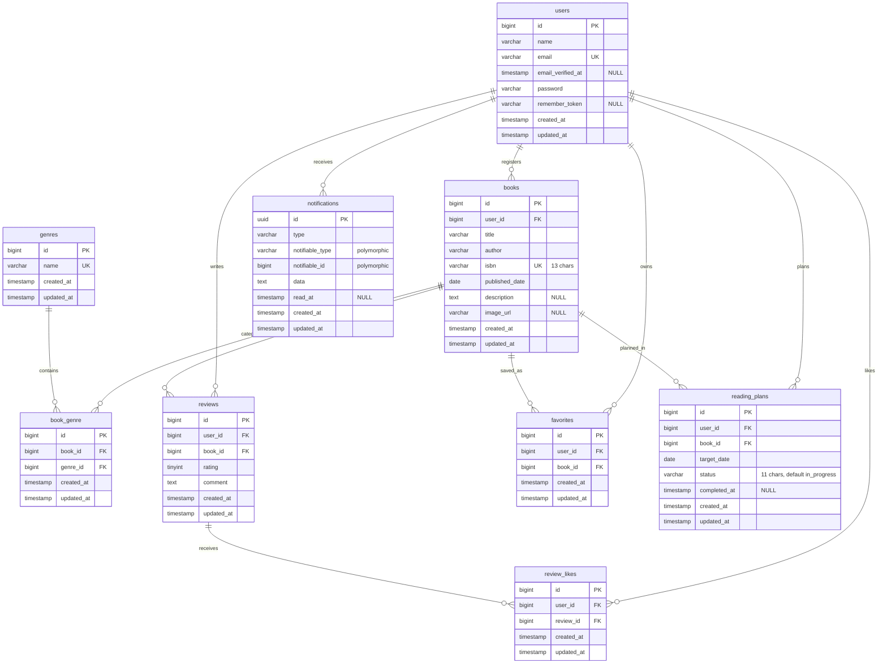

# BookShelf — 書籍レビュー・読書管理アプリ

## 概要

BookShelfは、書籍の登録・レビュー・検索に加え、読書計画、リマインダー通知、読書レポートを利用できるLaravel製Webアプリです。Google Books APIによるISBN検索と、Laravel Sanctumで認証する書籍APIも備えています。

## 主な機能

| 分類 | 機能 |
| --- | --- |
| 認証・書籍 | Fortifyによる会員登録・ログイン・ログアウト、書籍CRUD、ジャンル管理 |
| レビュー | 5段階評価・コメントの投稿／編集／削除、いいね、書籍ランキングTOP10 |
| お気に入り | お気に入りの登録・解除・一覧表示 |
| 書籍検索 | 書名・著者名の検索、ジャンル絞り込み、並び替え（新着・古い順・書名・評価）、ページネーション |
| ISBN検索 | Google Books APIから書籍情報を取得し、登録・編集フォームへの入力を補助 |
| マイ読書レポート | レビュー件数・平均評価・読了冊数・評価分布・高評価書籍／ジャンルTOP5 |
| 読書計画 | 登録・一覧・状態別絞り込み・期日変更・読了・削除 |
| 通知・バッチ | 期日3日前・当日・3日後のDB通知、既読管理、期限切れ更新・通知生成の日次バッチ |
| 書籍API | JSONによる一覧・詳細・登録・更新・削除（書き込みはSanctum認証） |

書籍の閲覧・ランキングはゲストも利用可能です。書籍の編集・削除、レビューの編集・削除、読書計画の操作などは、それぞれ権限を持つユーザーに制限しています。

## 使用技術

| 分類 | 技術 |
| --- | --- |
| バックエンド | PHP 8.5、Laravel 10、Fortify、Sanctum |
| データベース | MySQL 8.4 |
| フロントエンド | Blade、Tailwind CSS 3、Alpine.js、Vite |
| 開発環境 | Docker、Laravel Sail、phpMyAdmin |
| 外部連携 | Google Books API |
| テスト・整形 | PHPUnit、Laravel Pint |

※ バージョンは本リポジトリの開発環境・設定を基準に記載しています。

## 環境構築

**前提：** Git、Docker Desktop（起動済み）、インターネット接続。Windowsの場合はWSL2のターミナルを使用します。

本リポジトリにはLaravel 10、Sail、フロントエンドの設定、画面テンプレートが含まれています。初期構築時の`composer create-project`、`sail:install`、`tailwindcss init`や`resources/`の再配置は不要です。

### 1. リポジトリ取得・依存パッケージのインストール

```bash
git clone https://github.com/akiko-11/bookshelf-app.git
cd bookshelf-app
```

Sail起動前にComposer依存関係をインストールします。課題指定のComposer用Dockerイメージを使用する例（WSL2・macOS/Linux）：

```bash
docker run --rm \
  -u "$(id -u):$(id -g)" \
  -v "$(pwd):/var/www/html" \
  -w /var/www/html \
  -e COMPOSER_CACHE_DIR=/tmp/composer_cache \
  laravelsail/php82-composer:latest \
  composer install
```

互換性のあるPHP・Composerをローカルに導入済みなら、`composer install`でも構いません。上記は**初期インストール用のPHP 8.2イメージ**で、アプリ実行用Sailは`compose.yaml`で**PHP 8.5**を指定しています。クリーン環境での一連の手順は別途検証してください。

### 2. `.env`の設定

```bash
cp .env.example .env
```

`.env`のDB設定を次の値に変更し、Google Books APIキーを設定します。

```dotenv
DB_CONNECTION=mysql
DB_HOST=mysql
DB_PORT=3306
DB_DATABASE=laravel
DB_USERNAME=sail
DB_PASSWORD=password
GOOGLE_BOOKS_API_KEY=取得したAPIキー
```

Google CloudでBooks APIの利用設定とAPIキーの取得が必要です。`.env`やAPIキーはGitHubに公開しないでください。

### 3. Sail起動・初期化

```bash
./vendor/bin/sail up -d
./vendor/bin/sail artisan key:generate
./vendor/bin/sail npm install
./vendor/bin/sail artisan migrate --seed
```

`migrate --seed`で開発用のユーザー・書籍などを登録します。既存DBを**全削除して再作成**する場合のみ`./vendor/bin/sail artisan migrate:fresh --seed`を使用してください。

`config/app.php`の日本語設定（`locale = ja`）と`lang/ja/`は導入済みです。

### 4. Vite起動・アクセス

別ターミナルで実行します。

```bash
./vendor/bin/sail npm run dev
```

| 用途 | 開発環境URL |
| --- | --- |
| アプリ（書籍一覧） | http://localhost |
| 会員登録 | http://localhost/register |
| ログイン | http://localhost/login |
| phpMyAdmin | http://localhost:8080 |

停止：`./vendor/bin/sail down`。ポートを変更した場合は`.env`の設定値を使用してください。

## ER図・DB設計

主要な業務テーブルは9つです。`users`や`books`などは通常の外部キー、`notifications`はLaravelのポリモーフィック関連で紐づきます。



- **UNIQUE：** `users.email`、`genres.name`、`books.isbn`、`book_genre(book_id, genre_id)`、`reviews(user_id, book_id)`、`favorites(user_id, book_id)`、`review_likes(user_id, review_id)`。
- **外部キー：** `book_genre.genre_id`は削除時`RESTRICT`、その他の上記業務テーブルの外部キーは`CASCADE`。`notifications.notifiable_id`にはDB外部キー制約を設定していません。
- **読書計画：** `status`は`in_progress`、`completed`、`expired`。同一ユーザー・同一書籍の進行中計画の重複はアプリ側のバリデーションで防止します（DBの複合UNIQUE制約ではありません）。
- `personal_access_tokens`、`password_reset_tokens`、`failed_jobs`、`migrations`などの補助テーブルは図から省略しています。

## 書籍APIエンドポイント一覧

ベースパスは`/api/v1/books`。GETは認証不要、POST・PUT・DELETEは`auth:sanctum`が必要です。

| メソッド | パス | 概要 | 認証 | 成功時 |
| --- | --- | --- | --- | --- |
| GET | `/api/v1/books` | 書籍一覧・検索 | 不要 | 200 |
| GET | `/api/v1/books/{book}` | 書籍詳細 | 不要 | 200 |
| POST | `/api/v1/books` | 書籍登録 | Sanctum | 201 |
| PUT | `/api/v1/books/{book}` | 書籍更新 | Sanctum＋所有者 | 200 |
| DELETE | `/api/v1/books/{book}` | 書籍削除 | Sanctum＋所有者 | 204 |

- **GET一覧：** `keyword`（書名の部分一致）、`genre_id`、`page`、`per_page`（1～100、既定20）を指定できます。Web画面の検索は書名・著者名の両方が対象で、APIとは異なります。
- **POST・PUT：** `title`、`author`、13桁の`isbn`、`published_date`、1件以上の`genres`配列が必須。`description`、`image_url`は任意です。登録者は認証ユーザーから設定します。
- **主なエラー：** 401（未認証）、403（所有者以外）、404（書籍なし）、422（入力不正）。エラー時はJSONで返します。

## Google Books API連携

ログイン後、`GET /books/isbn/{isbn}`からISBN-13（13桁の数字）で書籍情報を検索し、入力補助用JSON（タイトル・著者・説明・表紙URL・出版日）を取得します。検索だけでは書籍登録されません。

Google Books APIの結果から**同じISBN-13を持つ書籍**を採用し、出版日は有効な`YYYY-MM-DD`形式のみ返します。

| HTTP | 内容 |
| --- | --- |
| 200 | 取得成功 |
| 422 | ISBNの形式が不正 |
| 404 | 一致する書籍がない（またはISBNを含まないURL） |
| 502 / 504 | 外部APIエラー / タイムアウト |

## 読書計画・通知・Scheduler

- **読書計画：** 進行中は期日変更・読了が可能。完了済みは編集・再読了不可（再読了時HTTP 409）。期限切れでも読了は可能です。操作は原則所有者本人に制限されます。
- **リマインダー：** 期日の3日前・当日・3日後にDB通知を生成します。3日前・当日は進行中、3日後は進行中・期限切れが対象で、同じ通知の重複生成を防止します。
- **日次バッチ：** `reading-plans:process`で期限切れ更新と通知生成を実施。`app/Console/Kernel.php`で**毎日20:00（Asia/Tokyo）**に設定されています。

```bash
# バッチを手動実行
./vendor/bin/sail artisan reading-plans:process

# スケジュールの確認
./vendor/bin/sail artisan schedule:list

# ローカル開発でスケジューラーを常駐（別ターミナル）
./vendor/bin/sail artisan schedule:work
```

Sailの起動だけでは日次処理は自動実行されません。本番環境では、例えばCronで毎分`php artisan schedule:run`を起動する設定が必要です（実行環境に合わせて調整）。

## 開発用ログイン情報

`migrate --seed`で作成されます。**開発用のみ**の情報です。

| 名前 | メールアドレス | パスワード |
| --- | --- | --- |
| 山田太郎 | `yamada@example.com` | `password` |
| 鈴木花子 | `suzuki@example.com` | `password` |
| 田中一郎 | `tanaka@example.com` | `password` |
| 佐藤美咲 | `sato@example.com` | `password` |
| 高橋健太 | `takahashi@example.com` | `password` |

## テスト・コード品質

```bash
./vendor/bin/sail artisan test                 # 全テスト
./vendor/bin/sail artisan test --coverage      # カバレッジ（Xdebug等が必要）
./vendor/bin/sail pint --test                  # コードスタイル確認
```

## 作成者

渡利明子